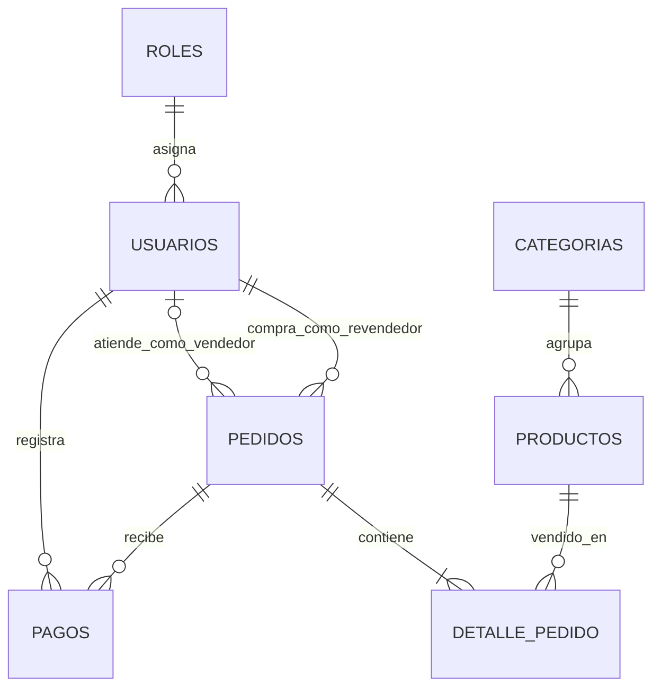

# Modelo entidad-relación

Un usuario tiene un rol. Cada producto pertenece a una categoría. Un pedido pertenece a un revendedor y puede ser atendido por un vendedor. El detalle relaciona productos con pedidos. Los pagos pertenecen a un pedido y guardan quién los registró.
