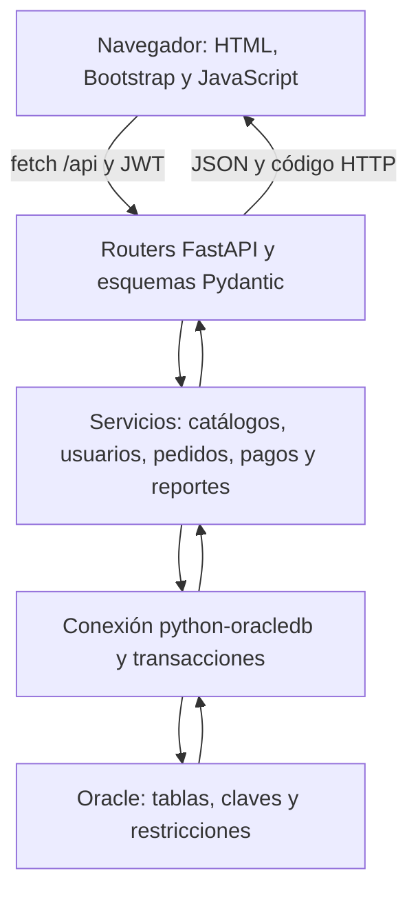

# Arquitectura y organización

El navegador solicita archivos de `/app/` y hace peticiones JSON a `/api/`. Los routers autentican y validan las solicitudes; los servicios aplican las reglas y ejecutan SQL parametrizado. Solo Python abre conexiones con Oracle.

| Carpeta/archivo | Responsabilidad |
|---|---|
| frontend/ | Login y aplicación responsive; no contiene SQL ni credenciales Oracle |
| backend/routers/ | Rutas HTTP, permisos y tipos de entrada |
| backend/schemas/ | Validación Pydantic |
| backend/services/ | Consultas y reglas del negocio |
| backend/database/ | Conexión, cierre, commit y rollback |
| backend/security.py | Hash de contraseñas, creación/verificación JWT y autorización |
| database/ | Modelo físico, restricciones, datos y consultas SQL |
| tests/ | Pruebas de API, reglas, transacciones y prueba optativa Oracle |

No se utiliza ORM, por lo que no hace falta duplicar las tablas en una carpeta `models/`. El modelo físico está en los scripts SQL y los contratos de entrada están en `schemas/`. La carpeta `pages/` tampoco es necesaria: las secciones de la interfaz se muestran desde `index.html` mediante navegación por hash.

## Petición de ejemplo

Crear cliente: formulario → `POST /api/clientes` con JSON y Bearer → `ClienteIn` → servicio del catálogo → `INSERT` con parámetros → `commit` → respuesta 201 → actualización de la tabla HTML. Un error de validación devuelve 422; una referencia o conflicto de integridad devuelve 400/409; una sesión inválida devuelve 401 y un permiso insuficiente, 403.

## Autenticación

`POST /api/auth/login` recibe JSON `{correo, contrasena}` y devuelve `access_token`. Swagger usa el esquema HTTP Bearer: ejecutar login y pegar **solo el token** en Authorize. El navegador guarda el token en sessionStorage y lo elimina al salir o recibir 401. Los permisos se vuelven a comprobar en la API y se consulta que el usuario continúe activo. No se guardan contraseñas en el navegador.

## Concurrencia básica

Los servicios bloquean la fila del pedido con `SELECT ... FOR UPDATE` antes de cambiar líneas o pagos. Reservar stock usa un UPDATE condicionado a la existencia disponible. La operación completa usa una conexión con commit al finalizar o rollback ante un error. Esto evita separar una reserva de su detalle o calcular dos pagos concurrentes del mismo pedido sobre el mismo saldo. No se pretende ofrecer garantías de una plataforma de producción.
