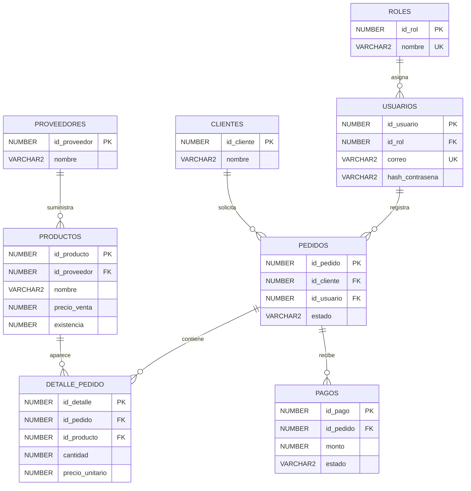

# Modelo entidad-relación

Se permite crear una cabecera de pedido sin líneas para completar su formulario después. Para avanzar del estado PENDIENTE, el pedido debe tener un total positivo. Las tablas pueden no tener registros hijos; cada registro hijo siempre tiene su padre correspondiente. La relación muchos a muchos entre pedidos y productos se resuelve mediante detalle_pedido.
